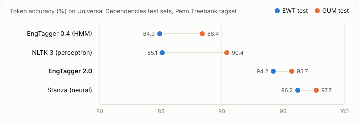

# EngTagger

English part-of-speech tagger library in pure Ruby

## Description

EngTagger assigns Penn Treebank-style part-of-speech tags to English text and
extracts nouns and noun phrases from the tagged result. Since version 2.0 the
tagger is an **averaged perceptron** with a bundled model — no external
dependencies, no Python, no network: `gem install engtagger` and everything
runs anywhere Ruby (>= 3.0) runs.

The tagging and extraction methods of the 0.4 line are kept, with considerably
more accurate tags. See [Upgrading from 0.4.x](#upgrading-from-04x) for what
was removed.

## Features

* Part-of-speech tagging with a corpus-trained averaged perceptron
* PTB/Universal Dependencies-compatible word tokenizer (non-destructive:
  every token is a substring of the input)
* Noun and noun-phrase extraction from tagged text
* Classic XML-style tagged output, or standard Penn Treebank tags via
  `tagset: :ptb`
* Pure Ruby, zero runtime dependencies, 2.4 MB bundled model
* One tagger object can be shared between threads

## Accuracy



Token accuracy (%) on the test splits of two Universal Dependencies English
treebanks — [EWT](https://universaldependencies.org/treebanks/en_ewt/) (web
media: reviews, emails, forums) and
[GUM](https://universaldependencies.org/treebanks/en_gum/) (multi-genre) —
using Penn Treebank tags, gold sentence boundaries and, except where noted,
gold tokenization (Universal Dependencies release 2.18):

| System | Algorithm | EWT test | GUM test |
|---|---|---|---|
| EngTagger 0.4.3 (previous) | HMM (bigram) | 84.9\* | 88.4\* |
| NLTK 3.10.3 | averaged perceptron, WSJ-trained | 85.1 | 90.4 |
| **EngTagger 2.0 (this gem)** | **averaged perceptron** | **94.2** | **95.7** |
| Stanza 1.15.1 (default model) | neural | 96.2 | 97.6 |

\* EngTagger 0.4.3 tokenizes its input itself, so it is scored on the
sentences it splits the same way as the treebank (71% of the tokens of EWT
test, 79% of GUM test). On those sentences EngTagger 2.0 scores 94.1 (EWT) and 95.8 (GUM).

## Synopsis

```ruby
require 'engtagger'

# Create a tagger object
tgr = EngTagger.new

# Sample text
text = "Alice chased the big black cat."

# Add part-of-speech tags to text
tagged = tgr.add_tags(text)

#=> "<nnp>Alice</nnp> <vbd>chased</vbd> <det>the</det> <jj>big</jj> <jj>black</jj> <nn>cat</nn> <pp>.</pp>"

# Get a list of all nouns and noun phrases with occurrence counts
word_list = tgr.get_words(text)

#=> {"Alice" => 1, "big black cat" => 1, "black cat" => 1, "cat" => 1}

# Get a readable version of the tagged text
readable = tgr.get_readable(text)

#=> "Alice/NNP chased/VBD the/DET big/JJ black/JJ cat/NN ./PP"

# Get all nouns from a tagged output
nouns = tgr.get_nouns(tagged)

#=> {"Alice" => 1, "cat" => 1}

# Get all proper nouns
proper = tgr.get_proper_nouns(tagged)

#=> {"Alice" => 1}

# Get all past tense verbs
pt_verbs = tgr.get_past_tense_verbs(tagged)

#=> {"chased" => 1}

# Get all the adjectives
adj = tgr.get_adjectives(tagged)

#=> {"big" => 1, "black" => 1}

# Get all noun phrases of any syntactic level
# (same as word_list but takes a tagged input)
nps = tgr.get_noun_phrases(tagged)

#=> {"Alice" => 1, "big black cat" => 1, "black cat" => 1, "cat" => 1}

# Standard Penn Treebank tags, if you prefer them over the classic tagset
ptb = EngTagger.new(tagset: :ptb)
ptb.get_readable(text)

#=> "Alice/NNP chased/VBD the/DT big/JJ black/JJ cat/NN ./."

ptb.tag_pairs("Alice chased the cat.")

#=> [["Alice", :NNP], ["chased", :VBD], ["the", :DT], ["cat", :NN], [".", :"."]]
```

## Options

```ruby
EngTagger.new(
  tagset: :ptb,              # standard tags from tag_pairs and get_readable (default: classic tagset)
  stem: true,                # stem the words returned by the extraction methods (default: false)
  longest_noun_phrase: 3,    # longest noun phrase to extract, in words (default: 5)
  weight_noun_phrases: true  # multiply the count of a noun phrase by its length in words (default: false)
)
```

## Tag Set

`add_tags`, `tag_pairs` and `get_readable` use the classic EngTagger tagset by
default: a modified Penn Treebank tagset in which tags with non-letter
characters are renamed to work in XML-style markup and regular expressions
(`DET` for `DT`, `PRPS` for `PRP$`, and named punctuation classes such as `PP`
for `.`). With `EngTagger.new(tagset: :ptb)`, `tag_pairs` and `get_readable`
emit standard Penn Treebank tags instead; `add_tags` always uses the classic
tagset. The text inside the tags is not escaped.

With `tagset: :ptb`, the extended Penn Treebank tags used by Universal
Dependencies also appear: `HYPH` (hyphen), `ADD` (e-mail address or URL),
`NFP` (emoticon or other superfluous punctuation), `AFX` (affix) and `GW`
(part of a word written apart). The classic tagset folds them into `PPC`,
`NN`, `SYM`, `JJ` and `NN`.

    CC      Conjunction, coordinating               and, or
    CD      Cardinal number                         3, fifteen
    DET     Determiner                              this, each, some
    EX      Pronoun, existential there              there
    FW      Foreign words
    IN      Preposition / Subordinating conjunction for, of, to, although, that
    JJ      Adjective                               happy, bad
    JJR     Adjective, comparative                  happier, worse
    JJS     Adjective, superlative                  happiest, worst
    LS      List item marker                        1, 2 (in lists)
    MD      Verb, modal                             can, could, 'll
    NN      Noun                                    aircraft, data
    NNP     Noun, proper                            London, Michael
    NNPS    Noun, proper, plural                    Australians, Methodists
    NNS     Noun, plural                            women, books
    PDT     Predeterminer                           all, half
    POS     Possessive ending                       's, '
    PRP     Pronoun, personal                       I, him, mine, yours
    PRPS    Determiner, possessive                  their, your
    RB      Adverb                                  often, not, very, here
    RBR     Adverb, comparative                     faster
    RBS     Adverb, superlative                     fastest
    RP      Particle                                up, off, out
    SYM     Symbol                                  *
    TO      Infinitive marker                       to (go)
    UH      Interjection                            oh, yes, mmm
    VB      Verb, base form                         take, live
    VBD     Verb, past tense                        took, lived
    VBG     Verb, gerund or present participle      taking, living
    VBN     Verb, past participle                   taken, lived
    VBP     Verb, present, non-3rd-person singular  take, am, are
    VBZ     Verb, present, 3rd-person singular      takes, is, has
    WDT     Wh-determiner                           which, whatever
    WP      Wh-pronoun                              who, whoever
    WPS     Possessive wh-pronoun                   whose
    WRB     Wh-adverb                               when, how, where

    PP      Punctuation, sentence ender             ., !, ?
    PPC     Punctuation, comma                      ,
    PPD     Punctuation, dollar sign                $
    PPL     Punctuation, quotation mark left        ``
    PPR     Punctuation, quotation mark right       ''
    PPS     Punctuation, colon, semicolon, ellipsis :, ;, ...
    LRB     Punctuation, left bracket               (, {, [
    RRB     Punctuation, right bracket              ), }, ]

## The bundled model

The tagger ships with an averaged-perceptron model
(`lib/engtagger/model.etm.gz`, distributed under CC BY-SA 4.0) trained on:

* the [Universal Dependencies English Web Treebank](https://github.com/UniversalDependencies/UD_English-EWT),
  whose annotations are licensed CC BY-SA 4.0;
* about 32,000 sentences from Wikipedia, Wikinews and Stack Exchange, tagged
  automatically with a large language model. Every article and post is listed
  with its licence in [`sources/`](https://github.com/yohasebe/engtagger/tree/master/sources).

## Installation

```bash
gem install engtagger
```

Pre-release versions are installed with `gem install engtagger --pre`.

## Upgrading from 0.4.x

* The tagging and extraction methods keep their names and arguments.
* Tagged output differs from 0.4.x: the tags come from a different,
  considerably more accurate engine.
* Tokenization follows PTB/UD conventions more closely (e.g. `don't` splits
  as `do|n't` and `well-known` as `well|-|known`).
* The configuration keys of the HMM engine (`:relax`, `:unknown_word_tag`,
  lexicon paths) are ignored with a warning.
* `install`, `EngTagger.hmm`, `EngTagger.lexicon` and the `DEFAULT_LEXPATH`,
  `DEFAULT_WORDPATH` and `DEFAULT_TAGPATH` constants were removed.
* The descriptions of several tags were corrected (see [Tag Set](#tag-set)),
  so the verbose names from `EngTagger.explain_tag`, `add_tags(text, true)`
  and `get_readable(text, true)` differ; update code that matches them.
* `assign_tag(prev_tag, word)` tags one word from the tag before it, without
  seeing the surrounding words; use `tag_pairs` or `add_tags` wherever the
  whole text is available.

If you need the old engine's exact output, pin the previous line:

```ruby
gem "engtagger", "~> 0.4"
```

## Author

Yoichiro Hasebe

EngTagger began as a Ruby port of Lingua::EN::Tagger by Aaron Coburn.

## License

This library is distributed under the GNU General Public License version 3
(GPL-3.0-only), the same license as the 0.4 line.
See the LICENSE file, and the NOTICE file for the licensing of the bundled
model and its training data.
